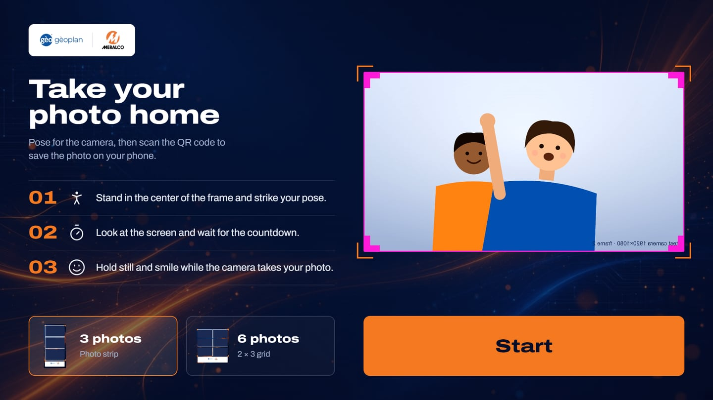

# We-Capture

Geoplan's event photobooth. A visitor takes 3 or 6 photos at the booth screen, the app frames them with the event branding, and the visitor scans a QR code to download the photo on their phone. No printer.

First event: **MIA 2026**, Geoplan × Meralco, "Transcending Excellence Through Innovation".



## How it works

1. **Booth** (`/`): steps screen → pick 3 or 6 photos → Start. Each shot gets a 3-2-1 countdown and a shutter flash, then a short review. 3 photos make a vertical strip; 6 make a 2×3 grid.
2. **Frame**: the shots are composed on a canvas at the camera's full resolution with the event background, logo panel, and theme line. Each slot is exactly the size of the camera frame, so nothing is cropped or shrunk, whether the camera is landscape or portrait.
3. **Upload**: a small JPEG preview goes to `/api/upload` first, which stores it in Cloudflare R2 under a random 128-bit id and returns the link, so the QR code appears within seconds. The full PNG is encoded and sent in the background (`PUT /api/upload/<id>`, authorized by a per-photo token) and lands as `photos/<id>.png`; it retries on its own and keeps going after the booth resets for the next visitor. A failed preview upload shows **Try again**; a failed PNG shows **Send again** under the QR.
4. **Download** (`/d/<id>`): mobile page with the photo preview and a name + email form. Submitting appends a row to the leads CSV and downloads `we-capture-<id>.png`. If the visitor gets there before the PNG has arrived, the page waits for it (up to 4 minutes) and then starts the download. Links don't expire. Unknown ids show a not-found page.

The result screen returns to the steps screen after 60 seconds untouched.

## Event branding

Everything event-specific is in [`lib/event.ts`](lib/event.ts) plus the files in `public/events/<slug>/`: logos, portrait and landscape backgrounds, theme line, colors, and the privacy line under the lead form. For the next event, add its assets and swap that object. The booth UI, frame, and download page all follow it.

## Setup

```bash
cp .env.example .env   # fill in R2 credentials and PUBLIC_BASE_URL
pnpm install
pnpm dev
```

| Variable | Purpose |
| --- | --- |
| `R2_ACCOUNT_ID` | Cloudflare account id (builds the R2 endpoint) |
| `R2_ACCESS_KEY_ID`, `R2_SECRET_ACCESS_KEY` | R2 API token with Object Read & Write on the bucket |
| `R2_BUCKET` | Bucket name |
| `PUBLIC_BASE_URL` | Origin the QR code points to, e.g. `https://wecapture.geoplanph.com`. Must be reachable from visitors' phones |
| `LEADS_CSV_PATH` | Leads CSV location. Default `/data/leads.csv` |
| `R2_ENDPOINT` | Optional. Override the S3 endpoint (local testing with MinIO or moto) |

R2 keys are only read by the server. The browser never sees them.

### Leads CSV

Columns: `timestamp` (ISO 8601, UTC), `photo_id`, `name`, `email`. The file starts with a UTF-8 byte order mark so Excel shows accented names correctly. Values that a spreadsheet would treat as formulas are prefixed with `'`. Rows are appended one write at a time, so simultaneous submissions don't interleave.

## Docker

```bash
docker compose up -d --build
```

The image uses Next.js standalone output and runs as a non-root user. Compose reads `.env` and mounts a named volume at `/data` for the leads CSV, so leads survive restarts and rebuilds. Photos live in R2, so `/d/<id>` links keep working across restarts.

`scripts/docker-smoke.sh` builds the image, runs it against a local S3 stand-in, and checks upload, download page, lead row, download, unknown id, and that the link and CSV survive a container recreate. CI runs it on every pull request.

Behind a reverse proxy, allow request bodies of at least 200 MB on `/api/upload/*`: a 6-photo grid from a 4K camera is a large PNG.

### Production CI/CD and VPS setup

Pushes to `main` run lint, build, and Docker smoke tests, then publish
`geoplanoperation/wecapture:latest` and deploy over SSH to
`https://wecapture.geoplanph.com`. No database or migration step is needed.

See [the deployment guide](docs/deployment.md) for GitHub secrets, one-time VPS
setup, and the replacement [production Compose file](docker-compose.prod.yml).
Keep the default `docker-compose.yml` for local development.

## Running the booth

- Open the booth in Chrome or Edge, full screen (`--kiosk`, or the **Full screen** button in settings). The camera needs HTTPS or `localhost`.
- **Operator settings**: long-press the logos on the steps screen for 1 second, or press `S`. Choose the camera, set the mount rotation for a camera mounted sideways, and choose whether saved photos are mirrored (off by default, so text reads correctly). Settings are saved in that browser.
- The live preview is mirrored like a mirror. The camera opens at its highest resolution; the settings sheet shows what it delivers.
- Testing aids: `?aspect=9:16` asks the browser to crop the camera to a shape, `?rotate=90` simulates a sideways mount, `?settings=1` opens settings on load.

## Scripts

```bash
pnpm dev     # dev server
pnpm build   # production build (standalone)
pnpm start   # serve the build (Docker runs node .next/standalone/server.js)
pnpm lint    # eslint
```
